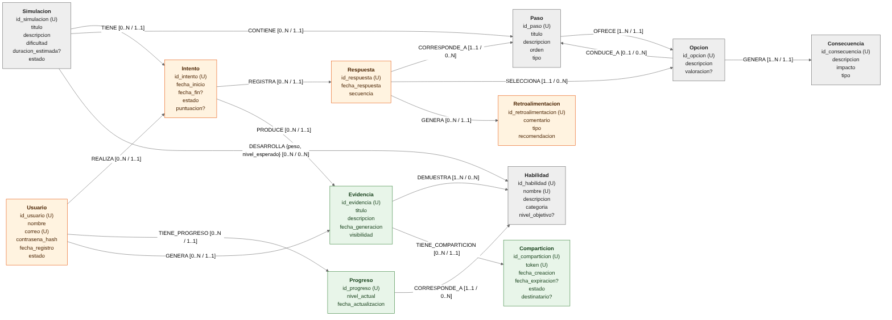
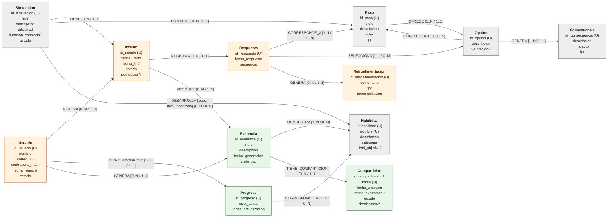

# Entregable 6. Diagrama del modelo lógico

**Proyecto:** QATO'K · **Fuente:** KG v1.1 · **Modelo:** grafo de propiedades para Neo4j

El modelo lógico une en un solo grafo lo definido en los entregables 2 (entidades y propiedades), 3 (relaciones), 4 (restricciones) y 5 (cardinalidades).

## 1. Diagrama

Fuente del diagrama (Mermaid; se visualiza en GitHub y en editores compatibles):

## 2. Leyenda

| Elemento | Significado |
|---|---|
| Caja | Nodo con su etiqueta (entidad) y sus propiedades almacenadas |
| `(U)` | Propiedad única (restricción de unicidad nativa en Neo4j) |
| `?` | Propiedad opcional; las demás son obligatorias |
| `destinatario?` en Comparticion | Propiedad *propuesta* (P-06); el resto de los elementos del diagrama forma parte del modelo adoptado |
| Flecha | Relación dirigida, del origen al destino |
| `TIPO {p1, p2}` | Tipo de relación y, entre llaves, sus propiedades |
| `[a / b]` | Cardinalidades: `a` = destinos por cada origen; `b` = orígenes por cada destino (entregable 5) |
| Gris | **Contenido** de las simulaciones: Simulacion, Paso, Opcion, Consecuencia, Habilidad |
| Naranja | **Ejecución** por parte del usuario: Usuario, Intento, Respuesta, Retroalimentacion |
| Verde | **Resultados** del aprendizaje: Progreso, Evidencia, Comparticion |

## 3. Lectura del modelo

El grafo se organiza en tres zonas conectadas:

1. **Contenido (gris).** Una `Simulacion` CONTIENE pasos. Cada `Paso` OFRECE opciones, cada `Opcion` GENERA consecuencias y CONDUCE_A otro paso. Así se forman las ramificaciones (MD-03). Una opción sin CONDUCE_A es terminal y cierra la ruta. El paso inicial es el de `orden = 1`. La simulación DESARROLLA habilidades con un `peso` y un `nivel_esperado` (MD-01).
2. **Ejecución (naranja).** Un `Usuario` REALIZA un `Intento` de una simulación (TIENE). El intento REGISTRA cada `Respuesta`, que CORRESPONDE_A un paso y SELECCIONA una opción. Así queda el recorrido exacto del usuario, ordenado por `secuencia` (MD-04). Cada respuesta puede generar (GENERA) `Retroalimentacion`.
3. **Resultados (verde).** El usuario TIENE_PROGRESO en cada habilidad (MD-02). Sus intentos PRODUCEN `Evidencia` que DEMUESTRA habilidades. Cada evidencia puede compartirse mediante `Comparticion` (MD-05).

`Habilidad` es el nodo que une las tres zonas: la alcanzan DESARROLLA (contenido), CORRESPONDE_A desde Progreso y DEMUESTRA (resultados). Por eso las consultas de recomendación, fortalezas y evidencias se resuelven con recorridos cortos sobre el grafo.

## 4. Comprobación: las consultas se resuelven sobre el diagrama

| Consulta | Recorrido en el diagrama | Saltos |
|---|---|---|
| C-01 Simulaciones según el progreso | Usuario → TIENE_PROGRESO → Progreso → CORRESPONDE_A → Habilidad ← DESARROLLA ← Simulacion | 3 |
| C-02 Fortalezas y áreas de mejora | Usuario → TIENE_PROGRESO → Progreso → CORRESPONDE_A → Habilidad ← DESARROLLA ← Simulacion → TIENE → Intento ← REALIZA ← Usuario; Intento → REGISTRA → Respuesta → GENERA → Retroalimentacion | 7 |
| C-03 Decisiones, consecuencias y retroalimentación | Usuario → REALIZA → Intento ← TIENE ← Simulacion; Intento → REGISTRA → Respuesta → CORRESPONDE_A → Paso; Respuesta → SELECCIONA → Opcion → GENERA → Consecuencia; Respuesta → GENERA → Retroalimentacion | 7 |
| C-04 Evidencias compartibles | Usuario → GENERA → Evidencia → DEMUESTRA → Habilidad; Simulacion → TIENE → Intento → PRODUCE → Evidencia → TIENE_COMPARTICION → Comparticion | 5 |
| C-05 Evolución de una habilidad | Usuario → REALIZA → Intento ← TIENE ← Simulacion → DESARROLLA → Habilidad ← CORRESPONDE_A ← Progreso ← TIENE_PROGRESO ← Usuario | 5 |

Las cinco consultas recorren solo relaciones del diagrama, en la dirección almacenada o en la inversa. Neo4j permite recorrer en ambos sentidos.

## 5. Resumen del modelo

| Elemento | Cantidad |
|---|---|
| Etiquetas de nodo | 12 |
| Relaciones (patrones origen–tipo–destino) | 17 |
| Tipos de relación distintos | 14 |
| Relaciones con propiedades | 1 (DESARROLLA: `peso`, `nivel_esperado`) |
| Propiedades almacenadas en nodos | 55 |
| Restricciones de integridad | 25 (entregable 4) |
