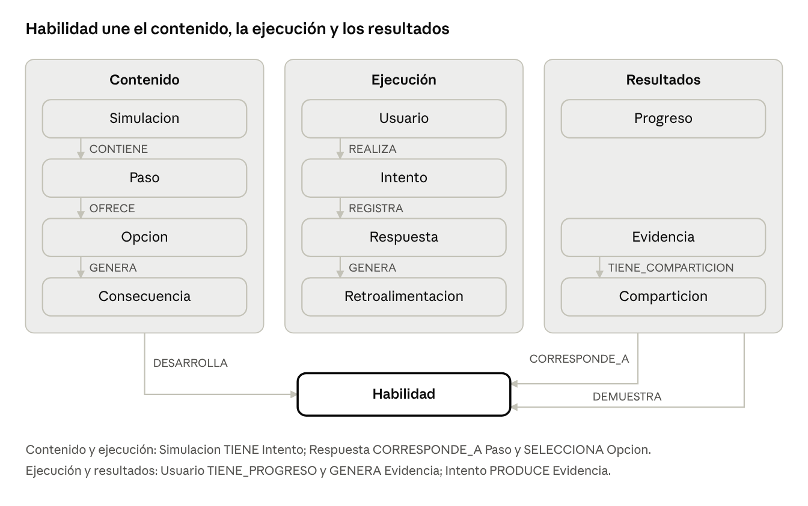

# Guía de estudio — Propuesta QATO'K

**Fecha:** 12 de noviembre de 2026 · **Versión editable:** documento de Claude Docs (enlace en `presentacion/README.md`)

## 1. La idea

QATO'K es una plataforma donde estudiantes por egresar practican situaciones laborales mediante simulaciones: toman decisiones, ven sus consecuencias, reciben retroalimentación y generan evidencias de lo que saben hacer.

**El problema.** Hay una brecha entre la formación académica y la capacidad de enfrentar, resolver y demostrar competencias en situaciones de trabajo reales. Sus causas: formación muy teórica, falta de experiencia formal, pocas oportunidades de decidir con información incompleta, dificultad para comunicar competencias en entrevistas y ausencia de retroalimentación.

**Para quién.** Estudiantes de último semestre, recién egresados y personas con formación académica pero poca experiencia laboral. Tienen poco tiempo, usan sobre todo el celular, a veces con mala conexión, y quieren controlar qué información comparten.

**La solución en una frase.** Simulaciones cortas y repetibles donde cada decisión tiene consecuencias y retroalimentación, con seguimiento del progreso por habilidad y evidencias que el usuario decide si comparte con empleadores.

| Necesidad del usuario | Cómo la atiende QATO'K |
| --- | --- |
| Practicar situaciones reales | Simulaciones con pasos y decisiones ramificadas |
| Decidir bajo incertidumbre | Cada opción genera consecuencias y lleva a otro paso |
| Saber qué hizo bien o mal | Retroalimentación por cada decisión (acierto, parcial, error) |
| Ver su avance | Progreso por habilidad, de 0 a 100 |
| Demostrar lo que sabe | Evidencias ligadas a la simulación que las originó |
| Privacidad | Evidencias privadas por defecto; se comparten con enlaces que caducan o se revocan |

## 2. El modelo en una mirada

El modelo tiene 12 entidades y 17 relaciones, organizadas en tres zonas que se conectan a través de Habilidad.

El contenido describe cada simulación; la ejecución registra lo que hizo el usuario; los resultados guardan su progreso y sus evidencias. Además, cada Opcion CONDUCE_A otro Paso: esa arista forma las ramificaciones, y una opción sin ella termina la simulación.

## 3. Los entregables

La actividad pide seis tablas o diagramas y unas conclusiones; los siete están terminados y verificados contra el grafo de conocimiento del proyecto (KG v1.1). Los archivos están en `entregables/` (Markdown) y `entregables/docx/` (Word).

| # | Entregable | Qué contiene | Cifra clave | Qué decir al presentarlo |
| --- | --- | --- | --- | --- |
| 1 | Requerimientos y consultas | Requerimientos funcionales, consultas que el sistema resuelve, su recorrido en Cypher y una matriz que los cruza | 10 RF; 5 consultas de 4 a 8 entidades (se pedían 8 y 2) | Las consultas son la razón del grafo: todas recorren varias entidades conectadas |
| 2 | Diccionario de entidades | Cada entidad con sus propiedades: tipo SQL y Neo4j, obligatoria y única | 12 entidades, 55 propiedades, mínimo 3 por entidad | Las claves foráneas no se guardan como propiedades: en el grafo son relaciones |
| 3 | Catálogo de relaciones | Origen, nombre, destino, descripción y dónde se usa cada relación | 17 relaciones, 14 tipos | Ninguna sobra: cada una la usa una consulta o una regla |
| 4 | Restricciones de integridad | Categoría, descripción y cómo se aplica en Neo4j | 25 restricciones (se pedían 8), las 5 categorías | Neo4j garantiza la unicidad; el resto se valida en la aplicación dentro de transacciones |
| 5 | Cardinalidades | Mínimos y máximos en ambos sentidos y si cada entidad puede existir sola | 3 entidades independientes, 9 dependientes | Las cardinalidades dicen qué nodos no pueden quedar huérfanos |
| 6 | Diagrama del modelo lógico | Grafo completo con propiedades, relaciones y cardinalidades | 12 nodos, 17 relaciones | Tres zonas unidas por Habilidad; las 5 consultas se resuelven en 3 a 7 saltos |
| 7 | Conclusiones | Respuesta a las dos preguntas del enunciado | 2 preguntas | No basta con las entidades: el modelo lo definen las relaciones y sus reglas |

**Cómo se trabajó.** Primero se auditó el KG y se encontraron 20 hallazgos; se resolvieron con 23 decisiones documentadas (DEC-01 a DEC-23). Cada entregable se revisó con tres técnicas (comparar alternativas, verificar cada afirmación contra la fuente y razonar por tres caminos independientes) hasta que una vuelta no produjo cambios. Un script compara todo contra el KG: 832 comprobaciones, 0 fallos.

## 4. Por qué encaja en una base de datos orientada a grafos

QATO'K encaja en un grafo porque lo valioso del dominio no son los datos sueltos, sino cómo se conectan: decisiones con consecuencias, experiencias con habilidades y habilidades con evidencias. Por eso Neo4j es la base principal y PostgreSQL la complementaria.

1. **El contenido ya es un grafo.** Una simulación no es una lista de pasos: cada opción CONDUCE_A otro paso, y varias rutas pueden converger. Eso son nodos y aristas dirigidas, y el grafo las guarda tal cual.
2. **Las preguntas importantes son recorridos.** Las cinco consultas cruzan de 4 a 8 entidades. Por ejemplo, reconstruir las decisiones de un usuario (C-03) va de Usuario a Intento, Respuesta, Paso, Opcion, Consecuencia y Retroalimentacion. En un grafo se escribe como un solo patrón; en SQL serían seis JOIN.
3. **Las relaciones llevan información.** DESARROLLA guarda el `peso` y el `nivel_esperado` de una simulación sobre una habilidad, sin tabla intermedia. Las relaciones de muchos a muchos (DESARROLLA, DEMUESTRA) son aristas directas.
4. **Habilidad conecta todo.** La alcanzan el contenido (DESARROLLA), el progreso (CORRESPONDE_A) y las evidencias (DEMUESTRA). Recomendar simulaciones, detectar fortalezas o mostrar evidencias de una habilidad son recorridos cortos desde ese nodo.
5. **El modelo crece sin romperse.** Agregar un historial de progreso o una relación entre una decisión y una habilidad es añadir nodos o aristas, no rediseñar tablas.

| Opción | Papel en QATO'K | Por qué |
| --- | --- | --- |
| Neo4j | Principal | Recorridos de varios saltos, ramificaciones, relaciones con propiedades |
| PostgreSQL | Complementaria | CHECK, UNIQUE, NOT NULL y transacciones para datos estructurados; qué datos guarda está pendiente (P-01) |
| MongoDB | Evaluada, descartada | Su flexibilidad de documentos no resuelve recorridos entre entidades y añadiría una tercera base |

**El precio del grafo.** Neo4j no tiene CHECK ni relaciones obligatorias: solo la unicidad funciona en cualquier edición. Por eso 23 de las 25 restricciones necesitan validación en la aplicación, dentro de la misma transacción que la escritura. Conviene decirlo antes de que lo pregunten: muestra que la elección se hizo conociendo sus límites.

## 5. Decisiones clave, propuestas y limitaciones

Estas son las decisiones que más probablemente salgan en la presentación; todas están justificadas en `docs/decisiones-modelado.md`.

| Decisión | Qué se decidió | Por qué |
| --- | --- | --- |
| Respuesta como nodo (MD-04) | Cada decisión del usuario es un nodo ligado a Intento, Paso, Opcion y Retroalimentacion | Una relación solo une dos nodos; la decisión toca cuatro |
| DESARROLLA con propiedades (MD-01) | Relación directa con `peso` y `nivel_esperado` | Evita un nodo intermedio y deja la información donde se usa |
| Opción terminal (DEC-03) | No hay pasos finales: una opción sin CONDUCE_A cierra el intento; el paso inicial es el de `orden = 1` | Así el desenlace queda registrado en una Respuesta y C-03 lo ve |
| `secuencia` en Respuesta (DEC-01) | Orden de cada respuesta dentro del intento | Cumple el mínimo de 3 propiedades y ordena el recorrido aunque se sincronice tarde |
| R06 en 1..N (DEC-02) | Toda opción tiene al menos una consecuencia | Corrige una contradicción del KG con OBS-03 y el concepto central |
| Relaciones redundantes (R09, R14) | Se mantienen | Acceso directo en C-03 y C-04, protegido por RI-10 y RI-14 |

**Propuestas** (dependen de decisiones aún pendientes y están marcadas así en los entregables): las listas de valores permitidos (estado del usuario, tipo de paso, impacto y tipo de consecuencia, tipo de retroalimentación, visibilidad, estado de compartición), la escala 0 a 100 de los niveles, el destinatario de una compartición y las restricciones RI-24 y RI-25.

**Limitaciones conocidas** (decirlas con naturalidad, no como fallas):

- C-02 atribuye el desempeño a una habilidad por simulación, no por decisión individual. Medirlo por decisión depende de cómo se calcule el nivel (P-03).
- C-05 aproxima la evolución con los intentos completados; el historial de progreso está pendiente (P-07).
- Falta decidir qué datos van en PostgreSQL y cómo se sincronizan las dos bases (P-01, P-02).

## 6. Preguntas probables y cómo responderlas

| Pregunta | Respuesta corta |
| --- | --- |
| ¿Por qué no una base relacional? | Las consultas clave recorren de 4 a 8 entidades; en SQL serían muchos JOIN o consultas recursivas. PostgreSQL sí se usa, pero como complemento para datos estructurados |
| ¿Por qué no MongoDB? | Se evaluó. Los documentos anidados sirven para contenido variable, pero no para recorrer relaciones entre usuarios, decisiones, habilidades y evidencias |
| ¿Qué hace Neo4j que una tabla no? | Guarda las conexiones como datos de primera clase, con dirección, tipo y propiedades, y las recorre sin JOIN |
| ¿Cómo garantizan la integridad si Neo4j no tiene CHECK? | Unicidad nativa en Neo4j; el resto en la aplicación, dentro de la transacción. Ejemplo: una respuesta solo se crea si la opción pertenece al paso y el paso a la simulación del intento |
| ¿Por qué Respuesta es un nodo y no una relación? | Porque se conecta con cuatro cosas a la vez: intento, paso, opción y retroalimentación |
| ¿Cómo termina una simulación? | Al elegir una opción terminal, sin CONDUCE_A; el intento pasa a COMPLETADO |
| ¿Qué entidad es la más importante? | Habilidad: conecta contenido, progreso y evidencias |
| ¿Cómo protegen la privacidad? | Evidencias privadas por defecto; se comparten con un token único que puede caducar o revocarse |
| ¿Qué falta por definir? | Cómo se calcula el nivel de habilidad, el historial de progreso y qué datos van en PostgreSQL |
| ¿Cómo saben que el modelo es correcto? | Cada entregable se verificó contra el KG con un script (832 comprobaciones, 0 fallos) y se revisó hasta una vuelta sin cambios |

## 7. Hoja de repaso

**Cifras:** 10 requerimientos · 5 consultas (4 a 8 entidades) · 12 entidades · 55 propiedades · 17 relaciones · 14 tipos de relación · 25 restricciones · 3 entidades independientes y 9 dependientes · 23 decisiones documentadas.

**Frases para cerrar cada parte:**

- La idea: “Practicar el trabajo antes de tenerlo, con decisiones que tienen consecuencias.”
- El modelo: “Tres zonas — contenido, ejecución y resultados — unidas por Habilidad.”
- El grafo: “Las preguntas importantes de QATO'K son recorridos, y un grafo está hecho para recorrer.”
- Las restricciones: “Neo4j garantiza la unicidad; lo demás lo garantiza la aplicación en cada transacción.”
- Las conclusiones: “Las entidades son el vocabulario; las relaciones y sus reglas son la gramática.”

**Nombres que hay que decir exactos:** REALIZA, TIENE, CONTIENE, DESARROLLA, OFRECE, GENERA, CONDUCE_A, REGISTRA, CORRESPONDE_A, SELECCIONA, TIENE_PROGRESO, PRODUCE, DEMUESTRA, TIENE_COMPARTICION.
