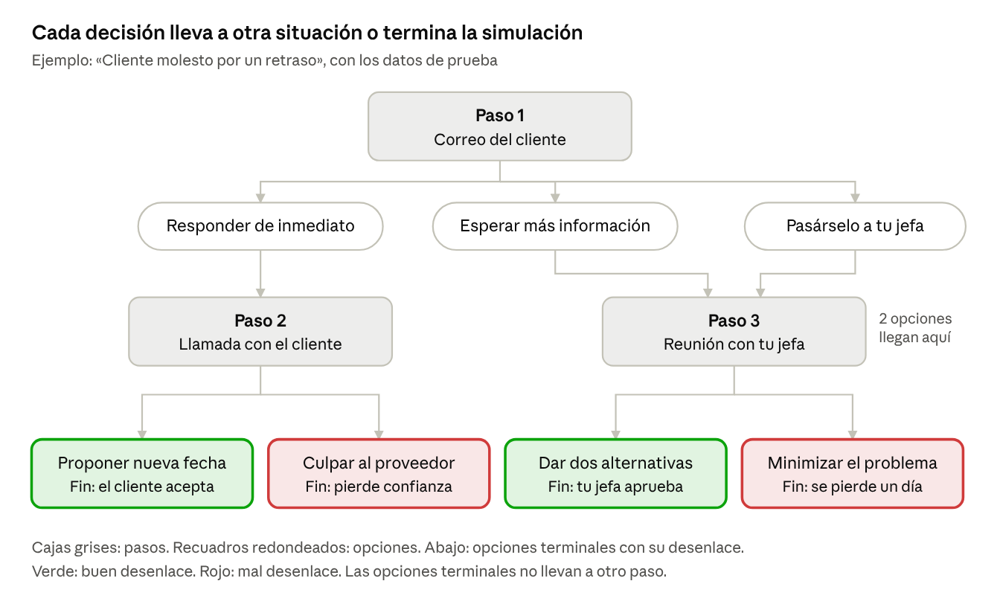

# QATO'K explicado

**Fecha:** 12 de noviembre de 2026 · **Versión editable:** documento de Claude Docs (enlace en `presentacion/README.md`)

Una explicación sin tecnicismos del proyecto: qué hace la aplicación, cómo se guarda su información y qué significan los códigos que aparecen en los entregables.

## 1. De qué trata QATO'K

QATO'K es una aplicación para practicar el trabajo antes de tenerlo. Funciona como un “simulador de vuelo”, pero para situaciones de oficina: un cliente molesto, una entrega que no llega a tiempo, una reunión difícil.

**El problema que resuelve.** Muchos estudiantes terminan la carrera sin experiencia laboral. Saben la teoría, pero no han tenido que decidir algo con prisa y con información incompleta, y les cuesta demostrar lo que saben hacer en una entrevista.

**La historia de Ana, una usuaria.**

1. Ana está en su último semestre y abre QATO'K en el celular, de camino a clase.
2. La aplicación le propone una simulación de 15 minutos: *Cliente molesto por un retraso*.
3. Le llega un correo del cliente y Ana elige qué hacer: responder de inmediato, esperar a tener más información o pasárselo a su jefa.
4. Cada elección tiene consecuencias y la lleva a una situación distinta, como en un libro de “elige tu propia aventura”.
5. Después de cada decisión recibe una explicación: qué hizo bien, qué no y cómo mejorar.
6. Su nivel en *Comunicación efectiva* sube, y la aplicación genera una evidencia de lo que demostró.
7. Ana decide si comparte esa evidencia con un reclutador mediante un enlace que puede caducar o cancelar.

**En una frase:** decisiones con consecuencias, retroalimentación inmediata, progreso por habilidad y evidencias que el usuario controla.

## 2. Cómo funciona una simulación

Una simulación es un camino con bifurcaciones: cada situación (paso) ofrece varias decisiones (opciones), y cada decisión tiene consecuencias y lleva a otra situación o termina la simulación.

Dos personas que juegan la misma simulación pueden vivir historias distintas. Cada vez que alguien juega se guarda un **intento**, y cada decisión que toma se guarda como una **respuesta** numerada (1, 2, 3…). Así después se puede reconstruir exactamente qué camino siguió.

## 3. Qué es una base de datos de grafos

Una base de datos de grafos guarda la información como una red: puntos conectados por flechas. Se parece a un mapa de metro o a la lista de amigos de una red social.

| Pieza | Qué es | Ejemplo en QATO'K |
| --- | --- | --- |
| Nodo | Una “cosa”: una persona, una simulación, una decisión | Ana; la simulación *Cliente molesto por un retraso* |
| Etiqueta | El tipo de nodo | `Usuario`, `Simulacion` |
| Relación | Una flecha con nombre que une dos nodos | Ana **REALIZA** un intento |
| Propiedad | Un dato guardado en un nodo o en una relación | `nombre: "Ana López"`; `peso: 0.6` en una relación |

**Por qué sirve para QATO'K.** En una base de datos tradicional (de tablas, como Excel), para unir información hay que cruzar tablas una por una. En un grafo, las conexiones ya están guardadas y basta con seguir las flechas. Y lo valioso de QATO'K son justamente las conexiones: qué decisión llevó a qué consecuencia, qué simulación desarrolla qué habilidad, qué evidencia demuestra qué.

**Qué base usamos.** Neo4j es la base principal, la de grafos. PostgreSQL, una base de tablas, queda como complemento para datos ordenados en filas; aún falta decidir cuáles guarda (P-01). MongoDB se evaluó y se descartó.

## 4. Las 12 piezas del modelo

El modelo tiene 12 tipos de nodo (entidades), agrupados en tres zonas: el contenido de las simulaciones, lo que hace el usuario y lo que obtiene. Los nombres van sin acento porque son nombres técnicos dentro de la base.

| Zona | Entidad | Qué representa | Ejemplo |
| --- | --- | --- | --- |
| Contenido | `Simulacion` | Un escenario completo de práctica | *Cliente molesto por un retraso* |
| Contenido | `Paso` | Una situación dentro de la simulación | El correo del cliente |
| Contenido | `Opcion` | Una decisión posible en un paso | “Responder de inmediato” |
| Contenido | `Consecuencia` | Lo que ocurre al elegir una opción | “El cliente acepta la llamada” |
| Contenido | `Habilidad` | Una competencia profesional | *Comunicación efectiva* |
| Ejecución | `Usuario` | La persona que practica | Ana |
| Ejecución | `Intento` | Una vez que el usuario juega una simulación | El intento de Ana del 1 de octubre |
| Ejecución | `Respuesta` | La decisión que tomó en un paso, con su número de orden | “En el paso 1 eligió responder de inmediato” |
| Ejecución | `Retroalimentacion` | La explicación de esa decisión | “Acierto: responder rápido baja la tensión” |
| Resultados | `Progreso` | El nivel actual del usuario en una habilidad, de 0 a 100 | Comunicación efectiva: 78 |
| Resultados | `Evidencia` | Constancia de una habilidad demostrada | “Manejo de un cliente molesto” |
| Resultados | `Comparticion` | Un enlace para mostrar una evidencia a alguien | Enlace para un reclutador |

**La pieza clave es `Habilidad`.** Conecta las tres zonas: las simulaciones la **desarrollan**, el progreso la **mide** y las evidencias la **demuestran**. Por eso casi todas las preguntas del sistema pasan por ella.

**Las relaciones** son las 17 flechas que unen estas piezas. Por ejemplo: un `Paso` **OFRECE** opciones, una `Opcion` **CONDUCE_A** otro paso, un `Usuario` **REALIZA** intentos y una `Evidencia` **DEMUESTRA** habilidades. La lista completa está en el entregable 3.

## 5. Qué significan los códigos

Los entregables usan códigos cortos para referirse a cada elemento sin repetir su descripción. La letra dice qué tipo de cosa es y el número la identifica.

| Código | Significa | Qué es, en palabras simples | Cuántos hay | Ejemplo |
| --- | --- | --- | --- | --- |
| RF-01 … RF-10 | Requerimiento funcional | Algo que la aplicación **debe poder hacer** | 10 | RF-05: explicar aciertos y errores después de cada decisión |
| C-01 … C-05 | Consulta | Una **pregunta importante** que la base de datos debe saber responder | 5 | C-01: ¿qué simulaciones le conviene hacer a este usuario? |
| E01 … E12 | Entidad | Un **tipo de nodo** del modelo | 12 | E07: Intento |
| R01 … R17 | Relación | Una **flecha** entre dos tipos de nodo | 17 | R01: Usuario REALIZA Intento |
| RI-01 … RI-25 | Restricción de integridad | Una **regla** que los datos deben cumplir siempre | 25 | RI-02: no puede haber dos usuarios con el mismo correo |
| MD-01 … MD-05 | Decisión de modelado | Cómo se decidió representar algo en el grafo | 5 | MD-04: cada decisión del usuario es un nodo `Respuesta` |
| DEC-01 … DEC-23 | Decisión de la auditoría | Una corrección o mejora decidida al revisar el modelo | 23 | DEC-03: las simulaciones terminan en una “opción terminal” |
| D-01 … D-14 | Decisión del proyecto | Una decisión general ya tomada | 14 | D-08: Neo4j es la base principal |
| P-01 … P-11 | Pendiente | Algo que **aún no se ha decidido** | 11 | P-03: cómo se calcula el nivel de una habilidad |
| OBS-01 … OBS-12 | Observación | Un hecho del dominio que guía el modelo | 12 | OBS-10: un usuario nuevo no tiene intentos ni progreso |
| LIM-01 … LIM-06 | Limitación conocida | Algo que el modelo actual no resuelve del todo | 6 | LIM-02: la evolución de una habilidad solo se aproxima |

**Una aclaración importante:** C-01 a C-05 **no son clases**: son **consultas**, es decir, preguntas. Se usan para justificar el modelo: si el grafo responde bien estas cinco preguntas, el diseño sirve. La siguiente sección las explica una por una.

## 6. Las 5 consultas, una por una

Cada consulta es una pregunta que la aplicación necesita responder para funcionar. Los resultados de abajo son reales: salen de ejecutar las consultas en Neo4j con los datos de ejemplo de Ana (usuaria con historial) y Bruno (usuario nuevo).

### C-01 · ¿Qué simulaciones le recomiendo?

- **Para qué sirve:** la pantalla de inicio, que sugiere qué practicar ahora.
- **Cómo la responde el grafo:** parte del usuario, mira su nivel en cada habilidad y busca las simulaciones publicadas que desarrollan las habilidades donde está por debajo de lo esperado. Ordena por dónde más le falta.
- **Ejemplo:** a Ana le recomienda primero *Tres entregas para mañana*, porque está en 40 en *Gestión del tiempo* y se esperan 60. A Bruno, que es nuevo, le muestra todas las simulaciones publicadas. Una simulación en borrador nunca aparece.

### C-02 · ¿En qué es bueno y en qué debe mejorar?

- **Para qué sirve:** el perfil del usuario, con sus fortalezas y áreas de mejora.
- **Cómo la responde el grafo:** compara el nivel de cada habilidad con su meta y cuenta los aciertos, aciertos parciales y errores de las simulaciones que la trabajan.
- **Ejemplo:** Ana es fuerte en *Comunicación efectiva* (78, meta 75) y debe mejorar en *Resolución de conflictos* (55, meta 70) y en *Gestión del tiempo* (40, meta 60).
- **Límite actual:** el desempeño se atribuye a la habilidad por simulación completa, no por cada decisión (LIM-01).

### C-03 · ¿Qué decidió, qué pasó y qué le explicamos?

- **Para qué sirve:** repasar una simulación ya jugada, decisión por decisión.
- **Cómo la responde el grafo:** sigue el camino Usuario → Intento → Respuesta → Paso y Opción → Consecuencia y Retroalimentación, en el orden en que respondió.
- **Ejemplo:** en su primer intento Ana esperó a tener más información y luego minimizó el problema (45 puntos). En el segundo respondió de inmediato y propuso una nueva fecha (92 puntos).

### C-04 · ¿Qué puede mostrarle a un empleador?

- **Para qué sirve:** la sección de evidencias para compartir con reclutadores.
- **Cómo la responde el grafo:** busca las evidencias del usuario que demuestran una habilidad, la simulación donde las obtuvo y solo los enlaces que siguen vigentes.
- **Ejemplo:** Ana tiene la evidencia *Manejo de un cliente molesto*. De sus tres enlaces solo aparece el vigente; el revocado y el caducado no.

### C-05 · ¿Cómo ha evolucionado una habilidad?

- **Para qué sirve:** una gráfica de avance en el tiempo.
- **Cómo la responde el grafo:** junta los intentos completados de simulaciones que desarrollan esa habilidad, ordenados por fecha.
- **Ejemplo:** en *Comunicación efectiva*, Ana pasó de 45 (septiembre) a 92 (1 de octubre) y a 65 (10 de octubre, en otra simulación). Su nivel consolidado es 78.
- **Límite actual:** es una aproximación basada en los intentos, porque el historial de mediciones aún no está definido (P-07).

## 7. Glosario

| Término | Qué significa |
| --- | --- |
| Base de datos de grafos | Base que guarda los datos como nodos conectados por relaciones |
| Neo4j | La base de datos de grafos que usa el proyecto |
| Cypher | El lenguaje para hacer preguntas a Neo4j; se escribe con dibujos de flechas, por ejemplo `(Usuario)-[:REALIZA]->(Intento)` |
| Modelo lógico | El diseño de qué se guarda y cómo se conecta, antes de programar la aplicación |
| Cardinalidad | Cuántos elementos puede tener una relación en cada extremo. “0..N” = de ninguno a muchos; “1..1” = exactamente uno |
| Restricción de integridad | Regla que impide guardar datos incorrectos, por ejemplo dos usuarios con el mismo correo |
| Índice | Atajo que la base crea para encontrar datos más rápido, como el índice de un libro |
| UUID | Identificador único y largo que recibe cada nodo, por ejemplo `e0000000-0000-4000-8000-000000000101` |
| Opción terminal | Una opción que no lleva a otro paso: al elegirla, la simulación termina |
| Intento | Cada vez que alguien juega una simulación; se puede repetir |
| Propuesta | Algo que decidimos nosotros para poder avanzar, pero que depende de un pendiente (P-xx) y puede cambiar |
| Prueba de humo | Prueba rápida para comprobar que lo básico funciona; en `neo4j/` hay 76 y todas pasan |
| KG (grafo de conocimiento) | El archivo `docs/KG.json` con toda la información del proyecto; es la fuente de verdad |
